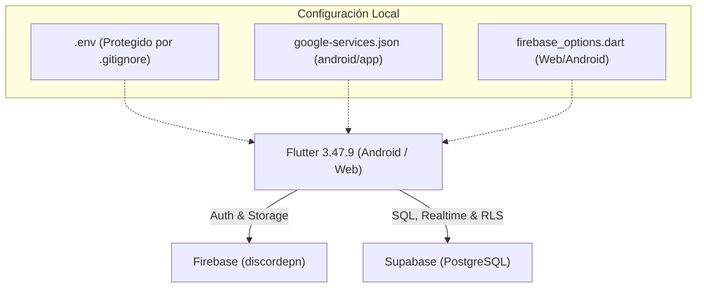

# 📌 Bitácora y Checkpoint Completo — Discord EPN
**Materia:** Aplicaciones Móviles 2026-B  
**Proyecto:** Discord EPN (Clon Híbrido de Discord con Supabase + Firebase)  
**Fecha de corte:** 7 de Noviembre de 2026  
**Estado:** Fases 1 a 5 Ejecutadas al 100% · Pruebas Unitarias Aprobadas (7/7) · Build Web Generado  

---

## 1. Resumen Ejecutivo del Proyecto

Se ha implementado de extremo a extremo la aplicación **Discord EPN**, integrando de manera sinérgica la arquitectura híbrida entre **Supabase** (PostgreSQL y Realtime WebSockets) y **Firebase** (Auth, Cloud Storage, FCM y Hosting), siguiendo la estética oficial Dark Theme de Discord.



---

## 2. Catálogo de Funcionalidades Implementadas (13/13)

| # | Funcionalidad | Proveedor / Tecnología | Estado |
| :---: | :--- | :--- | :---: |
| 1 | **Autenticación y Sesión:** Registro y Login con correo/contraseña | Firebase Auth + Supabase `profiles` | ✅ 100% |
| 2 | **Gestión de Perfil:** Edición de nombre, bio y avatar interactivo | Firebase Storage + Supabase | ✅ 100% |
| 3 | **Salas y Canales:** Canales `# general`, `# multimedia` y creación dinámica | Supabase PostgreSQL (`rooms`) | ✅ 100% |
| 4 | **Mensajería Persistente:** Envío y persistencia de texto | Supabase PostgreSQL (`messages`) | ✅ 100% |
| 5 | **Feed en Tiempo Real:** Replicación instantánea vía WebSockets | Supabase Realtime Channels | ✅ 100% |
| 6 | **Multimedia e Imágenes:** Subida progresiva y visualizador Lightbox | Firebase Storage (`chat_media/`) + Lightbox | ✅ 100% |
| 7 | **Geolocalización GPS:** Envío de coordenadas con tarjeta embebida | `geolocator` + Supabase lat/lng | ✅ 100% |
| 8 | **Notificaciones Push:** Solicitud de permisos y token | Firebase Cloud Messaging (FCM) | ✅ 100% |
| 9 | **Confirmación de Lectura:** Marcado de lectura en tiempo real | Supabase PostgreSQL (`message_reads`) | ✅ 100% |
| 10 | **Indicador de "Escribiendo...":** Broadcast instantáneo por canal | Supabase Realtime Broadcast | ✅ 100% |
| 11 | **Presencia en Vivo:** Puntos de conexión (Online/Offline) | Supabase `profiles.is_online` | ✅ 100% |
| 12 | **Reacciones Emoji:** Píldoras interactivas con conteo acumulado | Supabase (`message_reactions`) | ✅ 100% |
| 13 | **Notas de Voz:** Grabación desde micrófono y reproductor integrado | `record` + `audioplayers` + Firebase Storage | ✅ 100% |

---

## 3. Arquitectura del Código (`lib/`)

```
lib/
├── core/
│   ├── constants/
│   │   └── discord_colors.dart        # Paleta Discord (#1E1F22, #2B2D31, #313338, #5865F2, etc.)
│   ├── providers/
│   │   └── chat_provider.dart         # Estado global (Auth, Canales, Mensajes, Presencia, Typing)
│   └── services/
│       ├── auth_service.dart          # Login/Registro con Firebase Auth y sync a Supabase
│       ├── supabase_service.dart      # Queries SQL, Realtime, Perfiles, Mensajes y Reacciones
│       └── storage_service.dart       # Subida de avatares, fotos y notas de voz a Firebase Storage
├── models/
│   ├── user_profile.dart              # Modelo tipado de perfil y presencia
│   ├── room_model.dart                # Modelo de canal/sala
│   ├── message_model.dart             # Modelo polimórfico de mensaje (text, image, location, audio)
│   └── reaction_model.dart            # Modelo de reacciones con emoji
├── ui/
│   ├── auth/
│   │   ├── login_screen.dart          # Pantalla de login estilo Discord
│   │   └── register_screen.dart       # Pantalla de registro estilo Discord
│   ├── chat/
│   │   └── widgets/
│   │       ├── channel_sidebar.dart   # Lista de canales y dock inferior de usuario
│   │       ├── chat_input_bar.dart    # Barra de entrada de texto, adjuntos y nota de voz
│   │       ├── create_channel_dialog.dart # Modal para crear nuevos canales
│   │       ├── image_viewer_dialog.dart   # Lightbox interactivo de fotos
│   │       ├── members_sidebar.dart   # Barra de miembros en línea y desconectados
│   │       ├── message_bubble.dart    # Burbuja de mensaje plana, embeds, audio y reacciones
│   │       ├── server_sidebar.dart    # Barra lateral de servidores con iconos circulares
│   │       └── voice_record_dialog.dart   # Grabador de audio con cronómetro y selector
│   ├── home/
│   │   └── home_screen.dart           # Layout responsivo: Drawer (Móvil) / 3 Columnas (Web)
│   └── profile/
│       └── profile_dialog.dart        # Diálogo de edición de perfil y avatar
├── firebase_options.dart              # Opciones Firebase multiplataforma
└── main.dart                          # Inicialización de servicios, tema y AuthGate
```

---

## 4. Validación de Calidad y Pruebas

* **Análisis Estático (`flutter analyze`):** `No issues found!` (0 errores, 0 advertencias).
* **Suite de Pruebas Unitarias y Widgets (`flutter test`):**
  * `DiscordColors Constants Paleta oficial de Discord está correctamente definida`: **PASÓ**
  * `UserProfile Model Serialización y deserialización correcta`: **PASÓ**
  * `UserProfile Model copyWith preserva y modifica campos`: **PASÓ**
  * `RoomModel Model Serialización y deserialización correcta`: **PASÓ**
  * `ReactionModel Model Serialización y deserialización correcta`: **PASÓ**
  * `MessageModel Model Serialización y deserialización polimórfica`: **PASÓ**
  * `LoginScreen renderiza campos de Discord y formulario correctamente`: **PASÓ**
  * **Resultado global:** `7/7 tests passed!`
* **Compilación Web (`flutter build web`):**
  * Compilado satisfactoriamente en `build/web` listo para desplegar en Firebase Hosting.
