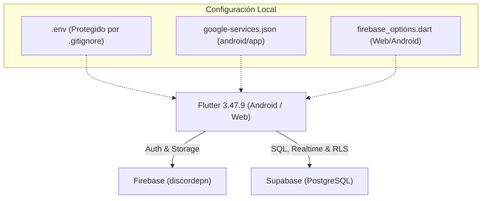

# 📌 Bitácora y Checkpoint Inicial — Discord EPN
**Materia:** Aplicaciones Móviles 2026-B  
**Proyecto:** Discord EPN (Clon Híbrido de Discord con Supabase + Firebase)  
**Fecha de corte:** 7 de Noviembre de 2026  
**Estado:** Fase 1 (Setup e Infraestructura) 100% Completada · Fase 2 Iniciada  

---

## 1. Resumen Ejecutivo del Checkpoint

Se ha levantado exitosamente la base técnica del proyecto desde cero, dejando el entorno de desarrollo, el repositorio Git, los servicios Cloud (Supabase y Firebase) y la arquitectura base de la aplicación Flutter completamente operativos y comunicados con pruebas de conexión verificadas en vivo.



---

## 2. Entorno de Desarrollo y Herramientas

* **SDK de Flutter:** Flutter 3.47.9 Stable (Dart 3.13.7) instalado en `D:\src\flutter\bin` y añadido al `PATH` del sistema.
* **Android SDK:** Configurado en `D:\AndroidSdk` (Android SDK 36.0.0, `cmdline-tools:latest`), licencias aceptadas y sin conflictos de rutas con espacios.
* **Diagnóstico de Salud (`flutter doctor`):**
  * `[✓] Flutter (Channel stable, 3.47.9)`
  * `[✓] Windows Version (Windows 11)`
  * `[✓] Android toolchain (Android SDK 36.0.0)`
  * `[✓] Chrome (Web development)`
  * `[✓] Visual Studio Community 2022`
  * `• No issues found!` (0 errores).
* **Control de Versiones (Git):**
  * Repositorio inicializado en rama `master`.
  * Archivo `.gitignore` blindado para proteger credenciales (`.env`, `**/google-services.json`, keystores y artefactos de compilación).
  * Commits atómicos realizados para registrar cada hito.

---

## 3. Infraestructura Cloud y Conectividad

### A. Supabase (PostgreSQL + Realtime WebSockets)
* **URL del Proyecto:** `https://murqsbmogqvujbzbomom.supabase.co`
* **Esquema de Base de Datos:**
  * `profiles`: Datos de usuario, bio, estado de presencia y avatar.
  * `rooms`: Canales del servidor (creados inicialmente `# general` y `# multimedia`).
  * `room_members`: Relación de miembros por canal.
  * `messages`: Mensajes de texto, multimedia, coordenadas GPS y notas de voz.
  * `message_reads`: Confirmaciones de lectura (Read receipts).
  * `message_reactions`: Reacciones acumuladas con emojis.
* **Seguridad y RLS (Row Level Security):**
  * Políticas de lectura y escritura creadas y habilitadas para usuarios públicos/autenticados.
  * Verificación en vivo: Petición HTTP GET con la clave pública `sb_publishable_...` probada con éxito (HTTP 200 devolviendo las salas existentes).
* **Replicación Realtime:** Tablas `messages` y `message_reactions` suscritas a la publicación `supabase_realtime`.

### B. Firebase (Auth + Cloud Storage + FCM + Hosting)
* **ID de Proyecto:** `discordepn`
* **Firebase Auth:** Proveedor de correo y contraseña habilitado.
* **Firebase Cloud Storage:** Bucket `discordepn.firebasestorage.app` activo en modo desarrollo para subida de fotos, audios y adjuntos.
* **Aplicación Android:** Paquete `com.epn.discord_epn` registrado con `google-services.json` instalado en `android/app/`.
* **Permisos Nativos en `AndroidManifest.xml`:**
  * `android.permission.INTERNET`
  * `android.permission.ACCESS_FINE_LOCATION`
  * `android.permission.ACCESS_COARSE_LOCATION`
  * `android.permission.RECORD_AUDIO`
  * `android.permission.POST_NOTIFICATIONS`
* **Aplicación Web:** Registrada y vinculada con Firebase Hosting.

---

## 4. Estructura de Código y Arquitectura Creada

```
lib/
├── core/
│   ├── constants/
│   │   └── discord_colors.dart        # Paleta oficial Dark Theme (#1E1F22, #2B2D31, #313338, #5865F2)
│   └── services/
│       ├── auth_service.dart          # Login/Registro con Firebase Auth y sync a Supabase
│       ├── supabase_service.dart      # Queries SQL, Realtime, Perfiles, Mensajes y Reacciones
│       └── storage_service.dart       # Subida de avatares, fotos del chat y notas de voz a Firebase
├── models/
│   ├── user_profile.dart              # Modelo tipado de perfil y estado de conexión
│   ├── room_model.dart                # Modelo tipado de canal/sala
│   ├── message_model.dart             # Modelo tipado de mensaje polimórfico (texto/foto/audio/gps)
│   └── reaction_model.dart            # Modelo tipado de reacciones con emoji
├── firebase_options.dart              # Configuración multiplataforma Web/Android
└── main.dart                          # Punto de entrada
```

---

## 5. Próximos Pasos de Construcción (Ruta Crítica)

1. **Pantallas de Autenticación (Fase 2):**
   * Crear `LoginView` y `RegisterView` con estética oscura de Discord.
   * Conectar con `AuthService` para registro en Firebase y guardado automático en `profiles` de Supabase.
2. **Layout y Navegación Principal estilo Discord (Fase 3):**
   * Crear `HomeScreen` responsiva: Drawer lateral en móvil con canales `# general` y `# multimedia`, y layout de 3 columnas fijas en Web.
   * Dock de usuario en la esquina inferior izquierda con avatar, nombre y estado de presencia.
3. **Feed de Mensajería en Tiempo Real (Fase 3):**
   * Burbujas planas estilo Discord (avatar a la izquierda, nombre, hora y contenido).
   * Barra de entrada de texto (`#383A40`) con botón `+` para multimedia y botón de enviar.
   * Suscripción WebSocket a `Supabase.client.from('messages').stream()`.
4. **Funcionalidades Multimedia y Hardware (Fase 4):**
   * Envío de imágenes con previsualización lightbox (Firebase Storage).
   * Compartir ubicación geográfica GPS con tarjeta interactiva (`geolocator`).
   * Reacciones interactivas con emojis bajo el mensaje.
   * Grabación y reproducción de notas de voz en el chat (`record` + `audioplayers`).
5. **Compilación y Despliegue (Fases 5 y 6):**
   * Despliegue web en Firebase Hosting (`flutter build web` + `firebase deploy`).
   * Generación del APK Release (`flutter build apk --release`).
   * Grabación de video y documentación final.
