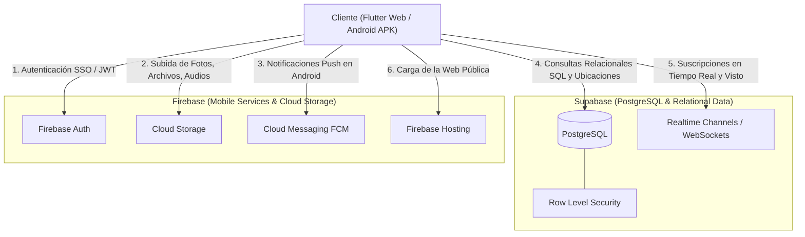
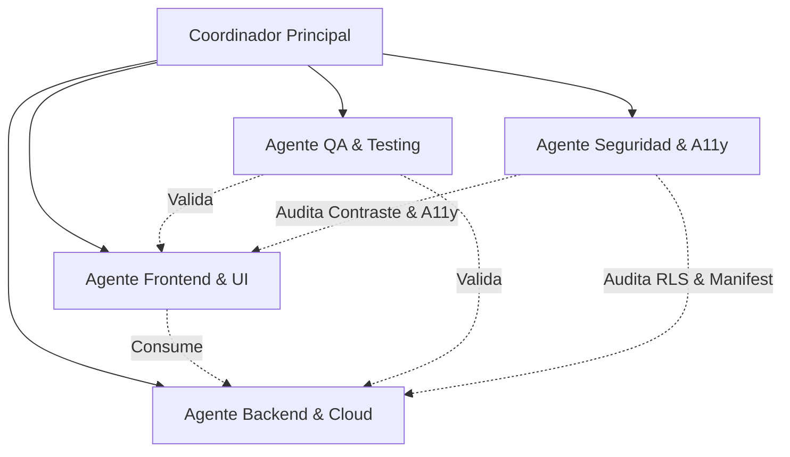

# Plan Maestro del Proyecto: Aplicación de Chat Híbrida (Discord Clone) con Supabase y Firebase
**Materia:** Aplicaciones Móviles 2026-B  
**Proyecto:** Discord EPN  
**Modalidad:** Parejas / Individual  

---

## 1. Resumen Ejecutivo y Entregables del Proyecto

El objetivo es desarrollar una aplicación de mensajería instantánea en tiempo real con estética y experiencia de usuario inspiradas en **Discord**, integrando **Supabase** y **Firebase** de forma simultánea y justificada, incorporando al menos 12 funcionalidades clave.

### Entregables Obligatorios
1. **APK Funcional:** Instalable en dispositivos Android (compilado en modo release, probado y subido a GitHub Releases).
2. **Repositorio de GitHub:** Código fuente limpio, estructura modular y `README.md` exhaustivo con capturas y explicación técnica.
3. **Aplicación Desplegada en la Web:** URL pública accesible con soporte HTTPS (desplegada en Firebase Hosting o Vercel).
4. **Video Demostrativo:** Publicado en redes sociales (YouTube / LinkedIn / etc.) mostrando la comunicación bidireccional en tiempo real entre dos cuentas y las funcionalidades requeridas.
5. **Seguridad y Credenciales:** Ninguna clave privada, token de servicio ni archivo sensible expuesto públicamente.

---

## 2. Arquitectura Híbrida: Supabase vs. Firebase

Se implementa una arquitectura **BaaS (Backend as a Service) / Serverless** que aprovecha las mejores capacidades de cada plataforma sin duplicar tareas:



### Matriz de Responsabilidades Técnicas

| Módulo / Servicio | Proveedor | Justificación Técnica |
| :--- | :--- | :--- |
| **Autenticación y Sesión** | **Firebase Auth** | Manejo robusto de cuentas (correo/contraseña y Google Sign-In), sincronización con FCM. |
| **Base de Datos Principal** | **Supabase (PostgreSQL)** | Modelo relacional estricto (usuarios, servidores, canales, miembros, mensajes y reacciones), consultas SQL complejas y soporte de coordenadas espaciales. |
| **Mensajería en Tiempo Real** | **Supabase Realtime** | Conexión WebSocket ultra-rápida nativa basada en la replicación lógica de PostgreSQL para actualización de feeds y estados. |
| **Almacenamiento de Multimedia** | **Firebase Storage** | Red global CDN para alojar imágenes, avatares, notas de voz y documentos adjuntos. |
| **Notificaciones en Segundo Plano** | **Firebase Cloud Messaging (FCM)** | Estándar de Android para despertar la app y mostrar notificaciones push cuando el chat está cerrado. |
| **Despliegue Web** | **Firebase Hosting** | Alojamiento CDN de alta velocidad para la versión web con certificado SSL/HTTPS automático y gratuito. |
| **Seguridad de Datos** | **Supabase RLS & Firebase Rules** | Reglas Row Level Security en Postgres para asegurar que solo miembros de un canal lean sus mensajes. |

---

## 3. Catálogo de Funcionalidades (13 Funcionalidades)

1. **Inicio de sesión y autenticación segura:** Registro e ingreso con correo y contraseña o Google Auth (Firebase Auth).
2. **Gestión y edición de perfil:** Cambio de nombre, biografía/estado personalizado y foto de avatar almacenada en Firebase Storage.
3. **Creación y administración de salas/servidores:** Creación de canales tipo Discord (`# general`, `# multimedia`) y chats directos.
4. **Envío y persistencia de mensajes de texto:** Mensajes sincronizados en tiempo real mediante WebSockets y almacenados en PostgreSQL.
5. **Historial de chat con scroll infinito:** Paginación de mensajes históricos ordenada cronológicamente.
6. **Envío de imágenes y archivos:** Carga progresiva a Firebase Storage con vista previa en miniatura y visualizador a pantalla completa (*lightbox*).
7. **Compartir ubicación geográfica:** Captura de coordenadas GPS (`latitude`, `longitude`) con tarjeta embebida de previsualización y botón de redirección a Google Maps.
8. **Notificaciones Push (FCM):** Notificación emergente nativa en Android cuando llega un mensaje y el usuario está fuera de la sala.
9. **Confirmación de lectura (Read Receipts):** Indicador visual de mensaje enviado, entregado y leído por los miembros.
10. **Indicador de "Escribiendo..." (Typing indicator):** Difusión instantánea en el canal cuando otro usuario redacta un mensaje.
11. **Estado de conexión en vivo (Presence):** Indicador con puntos de color en el avatar: En línea (verde), Ausente (amarillo), Ocupado (rojo), Desconectado (gris).
12. **Reacciones a mensajes:** Capacidad de reaccionar con emojis (`❤️`, `👍`, `🔥`, `😂`) acumulados en píldoras interactivas bajo el mensaje.
13. **Notas de voz / Audio (Funcionalidad Extra):** Grabación desde el micrófono, subida a Firebase Storage y reproducción en la burbuja del chat.

---

## 4. Diseño de Interfaz: Sistema de Diseño Estilo Discord

### Paleta de Colores Oficial (Dark Mode)
* **Fondo Servidores / Lateral Izquierdo:** `#1E1F22`
* **Fondo Canales / Barras Laterales:** `#2B2D31`
* **Fondo Principal de Mensajes:** `#313338`
* **Fondo de Barra de Entrada (Input) y Hover:** `#383A40`
* **Color Primario / Acento ("Blurple"):** `#5865F2`
* **Texto Primario:** `#F2F3F5`
* **Texto Secundario (Muted):** `#949BA4`
* **Estados de Presencia:**
  * Online: `#23A55A`
  * Ausente (Idle): `#F0B232`
  * No molestar (DND): `#F23F43`
  * Desconectado: `#80848E`

### Distribución de la Interfaz

#### En la Web (Layout de 3 o 4 Columnas)
* **Columna 1 (Servidores / Salas):** Iconos circulares (48x48 px) que se redondean en *squircles* al pasar el ratón, con píldora indicadora vertical a la izquierda y botón `+` para crear salas.
* **Columna 2 (Canales y Perfil):** Lista de canales con prefijo `#`, buscador superior y dock de usuario en la esquina inferior izquierda con avatar, estado de presencia y tuerca de ajustes.
* **Columna 3 (Feed de Chat):** Línea de tiempo continua sin burbujas separadas (estilo plano de Discord). Avatar de 40x40 px a la izquierda, nombre en negrita, hora en gris y píldoras de reacciones debajo.
* **Columna 4 (Lista de Miembros - Opcional/Colapsable):** Muestra los miembros de la sala agrupados en "En línea" y "Desconectados".
* **Barra de Entrada:** Caja redondeada (`#383A40`) con botón `+` para multimedia/GPS y selector de emojis.

#### En Android (APK Móvil)
* **Barra Superior (AppBar):** Botón hamburguesa `☰` para desplegar el drawer de servidores/canales, nombre del canal actual y botón de miembros `👥`.
* **Cuerpo:** Feed de mensajes con soporte táctil (pulsación larga para abrir menú de reacciones y opciones).
* **Barra Inferior:** Pestañas de navegación rápida: `Chats`, `Notificaciones` y `Tú (Perfil)`.

---

## 5. Esquema de Base de Datos (Supabase PostgreSQL)

Ejecutar este script en el **SQL Editor** del panel de Supabase:

```sql
-- 1. Tabla de Perfiles de Usuario
create table if not exists profiles (
  id text primary key, -- UID proveniente de Firebase Auth
  display_name text not null,
  avatar_url text,
  bio text default '¡Hola! Estoy usando Discord EPN.',
  is_online boolean default false,
  last_seen timestamp with time zone default now()
);

-- 2. Tabla de Salas / Servidores
create table if not exists rooms (
  id uuid default gen_random_uuid() primary key,
  name text not null,
  is_group boolean default false,
  avatar_url text,
  created_at timestamp with time zone default now()
);

-- 3. Miembros de las Salas
create table if not exists room_members (
  room_id uuid references rooms(id) on delete cascade,
  user_id text references profiles(id) on delete cascade,
  role text default 'member',
  joined_at timestamp with time zone default now(),
  primary key (room_id, user_id)
);

-- 4. Mensajes del Chat
create table if not exists messages (
  id uuid default gen_random_uuid() primary key,
  room_id uuid references rooms(id) on delete cascade,
  sender_id text references profiles(id) on delete cascade,
  content text,
  type text default 'text', -- 'text', 'image', 'file', 'location', 'audio'
  media_url text,           -- URL de Firebase Storage
  latitude double precision,
  longitude double precision,
  created_at timestamp with time zone default now()
);

-- 5. Confirmaciones de Lectura (Read Receipts)
create table if not exists message_reads (
  message_id uuid references messages(id) on delete cascade,
  user_id text references profiles(id) on delete cascade,
  read_at timestamp with time zone default now(),
  primary key (message_id, user_id)
);

-- 6. Reacciones a Mensajes
create table if not exists message_reactions (
  message_id uuid references messages(id) on delete cascade,
  user_id text references profiles(id) on delete cascade,
  reaction text not null, -- '❤️', '👍', '🔥', '😂'
  primary key (message_id, user_id, reaction)
);

-- Habilitar replicación Realtime
alter publication supabase_realtime add table messages;
alter publication supabase_realtime add table message_reactions;
```

---

## 6. Infraestructura y Despliegue: ¿Por qué NO se requiere VPS o RDP?

**No es necesario alquilar ni configurar un VPS ni un RDP.**
* **RDP:** Es solo una herramienta para controlar un escritorio remoto de Windows; no se utiliza en desarrollo moderno de aplicaciones móviles ni web.
* **VPS:** Solo se usaría si tuvieras que autogestionar el motor de base de datos, configurar Linux, Nginx y certificados SSL manualmente.
* **Enfoque Nube / Serverless (Recomendado y 100% Gratuito):**
  * **Base de datos y WebSockets:** Gestionados por Supabase Cloud (capa gratuita).
  * **Autenticación y Storage:** Gestionados por Firebase Cloud (Spark Plan gratuito).
  * **Despliegue Web:** Se realiza con **Firebase Hosting** mediante el comando `firebase deploy --only hosting` directo desde la PC local.
  * **Compilación del APK:** Se genera localmente con `flutter build apk --release` y se publica en GitHub Releases.

---

## 7. Plan de Implementación por Fases

```
[Fase 1: Setup & Seguridad] ➔ [Fase 2: Auth & Perfiles] ➔ [Fase 3: Core Chat & Realtime]
                                                                        │
[Fase 6: Entrega & Video]   ⬅ [Fase 5: Builds & Deploy] ⬅ [Fase 4: Multimedia & Push]
```

### Fase 1: Entorno, Proyectos y Seguridad
* **Agentes & Skills:** `Backend-Cloud-Agent` · `backend-security-coder`, `postgresql`, `firebase-auth-basics`.
* Crear proyecto en **Supabase** y ejecutar el DDL de base de datos.
* Crear proyecto en **Firebase**, habilitar Auth (Email y Google), Storage y Cloud Messaging.
* Configurar variables en `.env` y documentar `.env.example`.
* Asegurar que `.gitignore` excluya `.env`, `google-services.json`, keystores y claves privadas.

### Fase 2: Autenticación y Perfil de Usuario
* **Agentes & Skills:** `Frontend-Flutter-Agent`, `Backend-Cloud-Agent` · `flutter-apply-architecture-best-practices`, `firebase-auth-basics`, `frontend-security-coder`, `flutter-implement-json-serialization`.
* Diseñar pantallas de Login, Registro y Recuperación con estética oscura.
* Vincular registro con la inserción en la tabla `profiles` de Supabase.
* Crear la vista de edición de perfil (subida de foto de avatar a Firebase Storage).

### Fase 3: Core de Chat estilo Discord
* **Agentes & Skills:** `Frontend-Flutter-Agent`, `Backend-Cloud-Agent` · `flutter-apply-architecture-best-practices`, `flutter-add-widget-preview`, `postgresql`, `full-stack-orchestration-full-stack-feature`.
* Crear la estructura responsiva: Drawer lateral en móvil y columnas fijas en Web.
* Crear vistas de lista de servidores/canales e historial de chat.
* Implementar suscripción en tiempo real a la tabla `messages` vía Supabase Realtime.
* Implementar el indicador de "Escribiendo..." y estados de presencia (Online/Offline).

### Fase 4: Multimedia, Geolocalización y Notificaciones
* **Agentes & Skills:** `Frontend-Flutter-Agent`, `Backend-Cloud-Agent` · `backend-development-feature-development`, `frontend-security-coder`, `dart-run-static-analysis`.
* Integración del botón `+` para subir fotos a Firebase Storage con barra de progreso.
* Integración de `geolocator` para enviar latitud y longitud con tarjeta Embed de mapa.
* Integración de `firebase_messaging` para notificaciones push en segundo plano en Android.
* Agregar selector de reacciones emoji a cada mensaje.

### Fase 5: Compilación y Despliegue
* **Agentes & Skills:** `QA-Test-Agent`, `Backend-Cloud-Agent` · `dart-run-static-analysis`, `dart-fix-runtime-errors`, `debugger`.
* Compilación Web: `flutter build web --release` y despliegue en Firebase Hosting.
* Compilación APK: `flutter build apk --release` y pruebas en teléfonos físicos.
* Crear un *Release* en GitHub adjuntando el archivo `app-release.apk`.

### Fase 6: Documentación y Entrega
* **Agentes & Skills:** `Security-A11y-Agent`, `QA-Test-Agent` · `flutter_a11y_agent`, `wcag-audit-patterns`, `c4-architecture-c4-architecture`.
* Redacción del `README.md` final con capturas de pantalla, diagrama de arquitectura y guía de uso.
* Grabación del video demostrativo interactuando entre dos dispositivos y publicación en redes.

---

## 8. Asignación de Agentes y Skills Especializadas

Para maximizar la calidad de código, robustez y mantenibilidad, el desarrollo se organiza mediante **Agentes Especializados** que aplican **Skills Instaladas** específicas de Frontend, Backend, Seguridad y QA:

### Matriz de Skills Instaladas

| Categoría | Skill Especializada | Propósito y Aplicación en el Proyecto |
| :--- | :--- | :--- |
| **Frontend** | `flutter-apply-architecture-best-practices` | Arquitectura por capas (UI, Logic, Data) para modularizar vistas, servicios y proveedores. |
| **Frontend** | `flutter-add-widget-preview` | Previsualización interactiva de componentes del chat (burbujas, docks, selector de canales). |
| **Frontend** | `flutter-implement-json-serialization` | Mapeo tipado bidireccional (`fromJson`/`toJson`) entre respuestas JSON y modelos de datos. |
| **Frontend** | `frontend-security-coder` | Validación y sanitización de inputs en cliente, prevención de inyecciones y escape de caracteres. |
| **Frontend & A11y**| `wcag-audit-patterns` / `flutter_a11y_agent` | Auditoría de contraste, soporte de lectores de pantalla y accesibilidad táctil en móvil. |
| **Backend & Cloud**| `backend-development-feature-development` | Orquestación end-to-end de servicios cloud (`AuthService`, `SupabaseService`, `StorageService`). |
| **Backend & Cloud**| `backend-security-coder` | Reglas de seguridad RLS en Postgres, validación de tokens JWT y control de acceso a Storage. |
| **Backend & Cloud**| `postgresql` / `database-migrations-sql-migrations` | Gestión DDL de esquemas, optimización de índices para Realtime y claves foráneas en cascada. |
| **Backend & Cloud**| `firebase-auth-basics` | Implementación segura de flujos de registro, sesiones persistentes y gestión de usuarios. |
| **Backend & Cloud**| `api-design-principles` | Estandarización de contratos de datos para eventos en tiempo real y transacciones relacionales. |
| **Testing & QA** | `tdd-workflows-tdd-cycle` / `dart-add-unit-test` | Ciclo TDD y generación sistemática de pruebas unitarias sobre modelos y servicios. |
| **Testing & QA** | `dart-run-static-analysis` / `dart-fix-runtime-errors` | Ejecución de `flutter analyze`, corrección de lints y diagnóstico automático en tiempo de ejecución. |
| **Diagnóstico** | `debugger` / `error-detective` | Localización rápida de excepciones asíncronas y resolución de bugs en Web y Android. |
| **Orquestación** | `full-stack-orchestration-full-stack-feature` | Sincronización continua entre la interfaz Flutter y los eventos de Supabase / Firebase. |

### Configuración de Agentes para las Tareas



1. **Agente Frontend (`Frontend-Flutter-Agent`):**
   - **Responsabilidad:** Construcción de vistas (`LoginScreen`, `RegisterScreen`, `HomeScreen`), layout adaptativo (Drawer en móvil, 3 columnas fijas en Web), componentes del Dark Theme Discord y renderizado multimedia.
   - **Skills:** `flutter-apply-architecture-best-practices`, `flutter-add-widget-preview`, `frontend-security-coder`.
2. **Agente Backend & Cloud (`Backend-Cloud-Agent`):**
   - **Responsabilidad:** Conexión con Supabase (SQL, WebSockets, RLS) y Firebase (Auth, Storage buckets, FCM), persistencia y sincronización de presencia.
   - **Skills:** `backend-development-feature-development`, `backend-security-coder`, `postgresql`, `firebase-auth-basics`.
3. **Agente QA & Testing (`QA-Test-Agent`):**
   - **Responsabilidad:** Cobertura con pruebas unitarias (`test/`), análisis estático permanente con `dart analyze` y resolución de issues.
   - **Skills:** `dart-add-unit-test`, `dart-run-static-analysis`, `dart-fix-runtime-errors`, `debugger`.
4. **Agente de Seguridad & Accesibilidad (`Security-A11y-Agent`):**
   - **Responsabilidad:** Verificación de políticas RLS en Supabase, blindaje del `AndroidManifest.xml` y cumplimiento de WCAG 2.2.
   - **Skills:** `backend-security-coder`, `flutter_a11y_agent`, `wcag-audit-patterns`.

---

## 9. Distribución de Roles para el Trabajo en Parejas

| Módulo de Trabajo | Integrante 1 (Backend & Cloud Architect) | Integrante 2 (Frontend & Mobile Specialist) |
| :--- | :--- | :--- |
| **Bases de Datos & Auth** | Configuración de Supabase (tablas, RLS, Realtime) y Firebase Console. | Vistas de Login, Registro y edición de perfil estilo Discord. |
| **Lógica de Chat** | Manejo de canales de WebSocket, queries SQL de mensajes y presencia. | Layout de 3 columnas (Web) y Drawer (Móvil), burbujas y scroll. |
| **Multimedia & Hardware** | Subida de archivos a Firebase Storage y obtención de tokens FCM. | UI de cámara/galería, selector de emojis, embeds de mapas y audio. |
| **Despliegue & Entrega** | Despliegue a Firebase Hosting y redacción técnica del README. | Generación y testeo del APK, capturas y edición del video demo. |

---

## 10. Lista de Verificación (Checklist) para la Entrega

- [ ] Las 12+ funcionalidades operan correctamente en pruebas simultáneas.
- [ ] La interfaz refleja fielmente la estética oscura de Discord.
- [ ] La aplicación web está en línea con HTTPS y funciona en el navegador.
- [ ] El APK se instala y corre sin fallos en Android.
- [ ] El repositorio de GitHub cuenta con un README detallado y capturas de pantalla.
- [ ] No existen claves secretas ni archivos `google-services.json` expuestos en el código fuente.
- [ ] El video demostrativo muestra la interacción en vivo y está publicado en redes.
