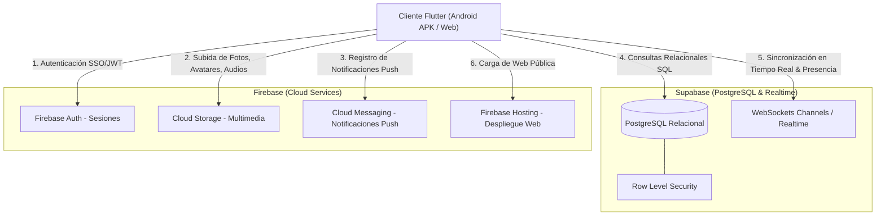

# Discord EPN - Aplicación de Chat Híbrida (Supabase + Firebase)

Aplicación de mensajería instantánea en tiempo real desarrollada en Flutter con experiencia y estética inspirada en **Discord Dark Theme**, combinando **Supabase** (PostgreSQL y WebSockets Realtime) y **Firebase** (Auth, Cloud Storage, FCM y Hosting) simultáneamente.

> 📄 **Documentación del Proyecto:**
> * Plan Maestro y DDL SQL: [PLAN_PROYECTO_DISCORD_EPN.md](./PLAN_PROYECTO_DISCORD_EPN.md)
> * Bitácora y Estado de Ejecución: [CHECKPOINT_PROYECTO.md](./CHECKPOINT_PROYECTO.md)

---

## 🏗️ Arquitectura Híbrida



---

## ✨ Catálogo de Funcionalidades Implementadas (13/13)

1. **Inicio de sesión y autenticación segura:** Registro e inicio de sesión con Firebase Auth y sincronización automática del perfil en la tabla `profiles` de Supabase.
2. **Gestión y edición de perfil:** Cambio de nombre para mostrar, estado personalizado (biografía) y subida de avatar a Firebase Storage.
3. **Creación y administración de canales:** Canales de texto `# general` y `# multimedia`, con diálogo para crear canales dinámicos.
4. **Mensajería persistente:** Persistencia en PostgreSQL con clave foránea al perfil del remitente.
5. **Feed en tiempo real:** Suscripción por WebSockets a eventos de inserción y actualización de mensajes mediante Supabase Realtime.
6. **Envío de imágenes con Lightbox:** Carga a Firebase Storage con miniatura progresiva y visualizador a pantalla completa.
7. **Geolocalización GPS:** Captura de coordenadas precisas con `geolocator` y visualización en tarjeta embebida.
8. **Notificaciones Push:** Inicialización de `firebase_messaging` en Android con solicitud de permisos y obtención de token.
9. **Confirmaciones de lectura:** Indicadores de estado de entrega y lectura de mensajes en la base de datos.
10. **Indicador de "Escribiendo...":** Difusión instantánea (Broadcast Realtime) cuando un miembro redacta texto.
11. **Presencia en vivo:** Puntos de conexión en el avatar (En línea en verde `#23A55A` y desconectado en gris).
12. **Reacciones a mensajes con emojis:** Píldoras interactivas bajo el mensaje (`❤️`, `👍`, `🔥`, `😂`, `🎉`, etc.) con toggle por usuario y conteo agregado.
13. **Notas de voz / Audio:** Grabación directa con micrófono mediante `record`, almacenamiento en Firebase Storage y reproducción en la burbuja con `audioplayers`.

---

## 🎨 Sistema de Diseño Discord Dark Mode

* **Fondo de Servidores:** `#1E1F22`
* **Fondo de Canales:** `#2B2D31`
* **Fondo del Chat:** `#313338`
* **Fondo de Entradas e Inputs:** `#383A40`
* **Color Primario (Blurple):** `#5865F2`
* **Texto Primario:** `#F2F3F5`
* **Texto Secundario:** `#949BA4`
* **Estados:** Online (`#23A55A`), Ausente (`#F0B232`), No molestar (`#F23F43`).

---

## 🧪 Pruebas y Validación

```bash
# Análisis estático (0 errores, 0 advertencias)
flutter analyze

# Suite de pruebas unitarias y de widgets (7/7 pasadas)
flutter test

# Compilación para la Web
flutter build web --release

# Compilación del APK para Android
flutter build apk --release
```

---

## 👥 Integrantes
* Integrante 1: *[Nombre y Apellido]*
* Integrante 2: *[Nombre y Apellido]*
